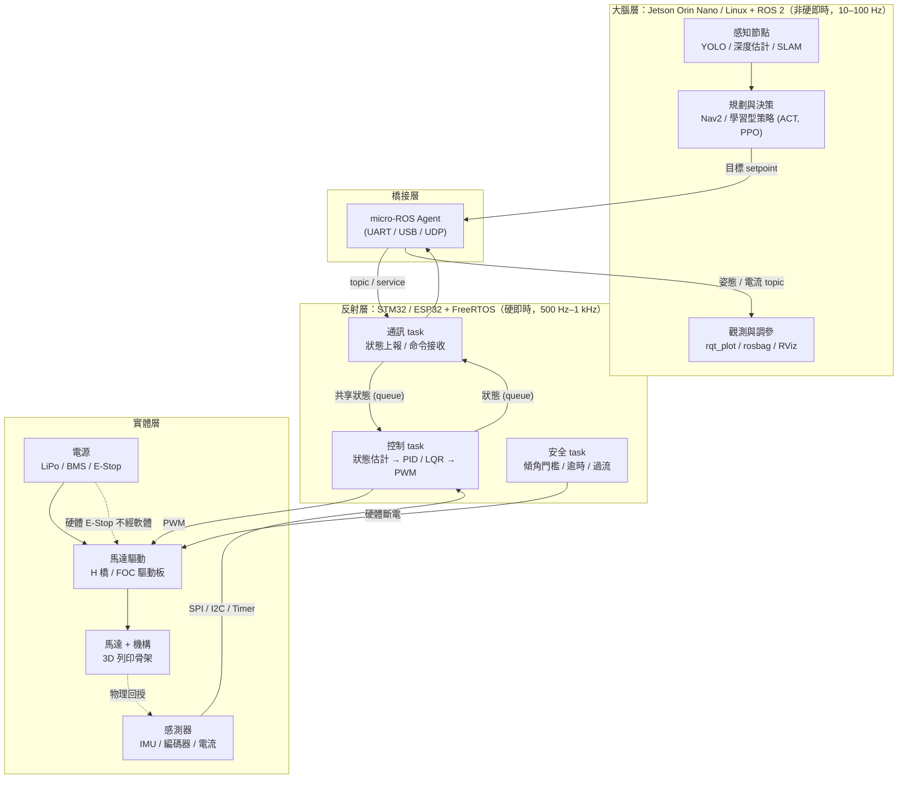
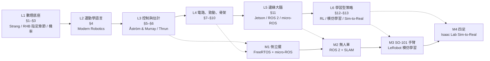
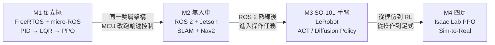

# Physical AI (Embodied AI) 跨領域自學工程架構手冊

> [!NOTE]
> 本 repo 是一份以**倒立擺**為起點的 Physical AI 自學路徑：涵蓋數理、運動學、控制、狀態估計、電路、致動、實體原型、邊緣運算，以及讓機器學會動作的強化學習與模仿學習。核心架構原則是 **MCU 負責反射（FreeRTOS），Jetson 負責大腦（ROS 2）**，兩者以 micro-ROS 橋接。

## 目錄

| 文件 | 內容 |
|---|---|
| [docs/curriculum.md](docs/curriculum.md) | 13 個核心模組與推薦書籍 |
| [docs/m1-inverted-pendulum.md](docs/m1-inverted-pendulum.md) | M1 倒立擺詳細設計：控制迴路、FreeRTOS task、硬體清單 |
| [docs/mechanics/](docs/mechanics/README.md) | M1 前置教材：力學（對應《Elementary Mechanics Using Python》）→ Lagrangian → PID / LQR / 甩起，附可執行驗證程式 |
| [docs/milestones.md](docs/milestones.md) | 四階段實作里程碑與驗收標準 |
| [CHANGELOG.md](CHANGELOG.md) | 版本變更摘要 |

## 實作目錄

| 目錄 | 里程碑 |
|---|---|
| [m1-inverted-pendulum/](m1-inverted-pendulum/) | FreeRTOS 韌體、micro-ROS 設定、CAD 檔 |
| [m2-diff-drive-rover/](m2-diff-drive-rover/) | ROS 2 workspace、SLAM 與 Nav2 設定 |
| [m3-so101-lerobot/](m3-so101-lerobot/) | LeRobot 資料集與策略訓練 |
| [m4-quadruped-isaac-lab/](m4-quadruped-isaac-lab/) | Isaac Lab 訓練腳本與部署 |

---

## 系統架構總覽 (System Architecture)

### 1.1 雙層架構：反射層與大腦層

實體 AI 的核心工程決策是**把硬即時的控制迴路與非即時的感知決策分開**。前者跑在 MCU（FreeRTOS），後者跑在 Linux（Jetson + ROS 2）。這個架構從倒立擺一路沿用到無人車、手臂與四足，不需重構。

**設計原則**
1. 控制迴路永遠不跨越橋接層。Jetson 只送目標值（setpoint），不直接輸出 PWM。
2. 反射層在失去大腦層時仍能安全運作（保持平衡或安全停機）。
3. 硬體 E-Stop 直接切斷動力電，不依賴任何軟體。

### 1.2 為什麼 FreeRTOS 與 ROS 2 是分工而非二選一

| 面向 | FreeRTOS（反射層） | ROS 2（大腦層） |
|---|---|---|
| 執行環境 | STM32 / ESP32 裸機 + RTOS | Linux（Jetson） |
| 時序保證 | 硬體 timer 觸發，抖動微秒級 | 非硬即時；DDS 延遲毫秒級，即使加 PREEMPT_RT 仍不適合 1 kHz 迴路 |
| 適合工作 | 感測讀取、狀態估計、控制律、安全監控 | 感知、SLAM、路徑規劃、學習型策略、資料記錄 |
| 學習價值 | 中斷 / ISR、task 優先權、race condition、資料交換 | 分散式節點、tf2、Nav2、模擬器對接 |
| 在本路徑的位置 | M1 起 | M1 後半（透過 micro-ROS）、M2 起全面使用 |

倒立擺需要 500 Hz–1 kHz 的迴路，抖動超過數十微秒平衡就會退化，因此控制律必須留在 MCU。ROS 2 若在 M1 就引入，會把中斷處理、編碼器讀取、優先權設計這些底層手感包掉，失去 M1 的學習目的。

---

## 學習路徑技術總覽 (Technical Progression)

| 層次 | 主題 | 對應章節 | 實作里程碑 |
|---|---|---|---|
| 1 | 數理底座 | §1–§3 | — |
| 2 | 運動學語言 | §4 | 紙上推導倒立擺與兩軸手臂的狀態方程 |
| 3 | 控制、感知與狀態估計 | §5–§6 | **M1：倒立擺** |
| 4 | 電路、致動與實體骨架 | §7–§10 | （M1 共用） |
| 5 | 邊緣運算大腦 | §11 | **M2：無人車** |
| 6 | 學習型策略與虛實遷移 | §12–§13 | **M3：手臂** / **M4：四足** |

---

## 實作主線摘要

- **M1 倒立擺**：一顆 MCU、一顆馬達、一組感測器走完「感測 → 估計 → 控制律 → 致動」，PID → LQR → PPO。詳見 [docs/m1-inverted-pendulum.md](docs/m1-inverted-pendulum.md)。
- **M2 無人車**：同一雙層架構，MCU 改跑輪速控制，Jetson 跑 SLAM 與 Nav2。
- **M3 SO-101 手臂**：LeRobot 遙操作收集資料，訓練 ACT / Diffusion Policy。
- **M4 四足**：Isaac Lab PPO + Domain Randomization，Sim-to-Real。

完整驗收標準見 [docs/milestones.md](docs/milestones.md)。
