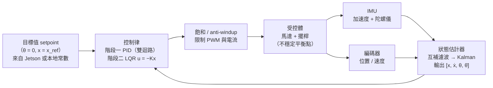
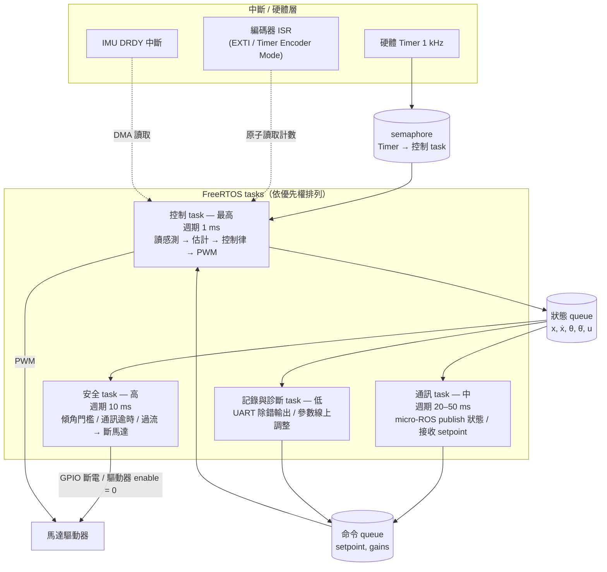

# M1 倒立擺：詳細設計

### 4.1 為什麼從倒立擺開始
* 一顆 MCU、一顆馬達、一組感測器就能完整走過「感測 → 狀態估計 → 控制律 → 致動」。
* 它同時是控制理論（LQR）、狀態估計（Kalman）與 RL（CartPole）的經典題目，一個硬體可以貫穿三個層次。
* 失敗成本接近零；比雲台多了 IMU 與不穩定平衡點，比無人車少了被現成軟體包掉的風險。
* **不選無人機**：飛控（PX4 / Betaflight）把控制迴路封成黑盒，自寫姿態控制門檻高、炸機成本高，與 Physical AI 主流方向（操作、足式）關聯較弱，可作支線。

### 4.2 控制迴路架構

**兩階段控制器驗收**
1. **PID 雙迴路**：內迴路穩定傾角 θ，外迴路調整位置 x。能站穩即可，理解 Kp / Ki / Kd 各自影響。
2. **LQR**：由拉格朗日方程推導狀態方程，在平衡點線性化，求解 Riccati 方程得增益 K。比較兩者對擾動的響應（超調、恢復時間、控制量峰值）。

> [!TIP]
> 上機前可先在模擬中走完同一條路：[Lagrangian 推導 cart-pole](mechanics/b1-lagrangian-cartpole.md) → [LQR](mechanics/c2-cartpole-lqr.md) → [能量式甩起](mechanics/c3-swingup.md) → [取樣、延遲與雜訊](mechanics/c4-digital-control.md)。最後一課可用來估算控制 task 需要的頻率與延遲預算。

### 4.3 FreeRTOS task 設計

> [!WARNING]
> 安全 task 是軟體層防線，硬體 E-Stop 是最後防線，兩者缺一不可。

**設計要點**
* 控制 task 由硬體 timer 經 semaphore 喚醒，不用 `vTaskDelay`，避免累積抖動。
* ISR 只做最少的事（讀計數、觸發 DMA），計算全部在 task 內。
* 感測資料以 queue 或受 mutex 保護的結構體交換，避免 race condition；用 `configASSERT` 與 stack high-water mark 檢查 task 記憶體。
* 安全 task 獨立於控制 task，即使控制 task 卡死（watchdog 偵測）仍能斷電。
* 通訊 task 頻率低於控制 task，micro-ROS 的 executor 不得阻塞控制迴路。

### 4.4 M1 硬體清單（建議）
| 類別 | 建議 | 對應章節 |
|---|---|---|
| MCU | STM32（F4 / G4 系列，硬體編碼器模式）或 ESP32 | §1, §7 |
| 馬達 | 帶編碼器的 DC 減速馬達（入門）或 BLDC + SimpleFOC 驅動板（進階） | §8 |
| 驅動 | H 橋驅動板，具電流回授與 enable 腳位 | §7, §8 |
| IMU | 6 軸 IMU（如 MPU-6050 / ICM-42688 級別），SPI 介面優先 | §6, §7 |
| 電源 | 2S–3S LiPo + BMS + 保險絲 + 硬體 E-Stop 開關 | §9 |
| 機構 | 自行 CAD 並 3D 列印擺桿、馬達座、輪組或滑軌 | §10 |
| 上位機 | 開發 PC（後半段換 Jetson）跑 micro-ROS Agent 與 rqt_plot | §11 |

### 4.5 M1 → M2 的過渡
1. M1 前半：裸機或 FreeRTOS，UART 印狀態，用串列繪圖工具調參。
2. M1 後半：導入 micro-ROS，把狀態發成 topic，在 PC 端用 rqt_plot / rosbag 觀察，用 service 線上改增益。
3. M1 延伸：在 MuJoCo 建立同一台倒立擺，訓練 PPO，嘗試部署——第一次 Sim-to-Real。
4. M2：同一套「MCU 反射 + Jetson 大腦 + micro-ROS」架構，MCU 改跑差速輪速控制，Jetson 接 LiDAR 跑 SLAM 與 Nav2。
