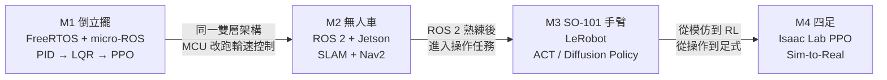

# 實作主線 (Hands-on Milestones)

### M1：倒立擺 — 建立控制與即時系統手感
* 詳見 [m1-inverted-pendulum.md](m1-inverted-pendulum.md)。
* **驗收**：手動擾動後一秒內回到平衡且不振盪；PID 與 LQR 皆能站穩並能比較兩者；micro-ROS topic 可在 PC 端即時繪圖；安全 task 能在傾倒時斷電。
* **對應章節**：§4、§5、§6、§7、§8、§9、§10、§11（micro-ROS）。

### M2：無人車 — ROS 2、Jetson 與 SLAM
* 輪式底盤是 ROS 2、Jetson、LiDAR 最自然的載體且不會摔壞。放在 M1 之後，是因為現成 motor driver 與 Nav2 會把控制與電機層包掉。
* **硬體**：Jetson Orin Nano、差速底盤（2 顆帶編碼器馬達，MCU 跑 FreeRTOS 輪速控制）、2D LiDAR、IMU、深度相機（選配）。
* **驗收**：在未知室內環境建圖並自主導航到指定點；能讀懂 tf2 座標樹與 Nav2 costmap。
* **對應章節**：§4、§6、§11。

### M3：SO-101 手臂 + LeRobot — 模仿學習
* 組裝 leader + follower，遙操作收集 50–100 筆示範，訓練 ACT 或 Diffusion Policy，部署完成抓取放置。
* **驗收**：對未見過的物體位置仍有可接受成功率；能說明資料多樣性對泛化的影響。
* **對應章節**：§4、§12。

### M4：Isaac Lab 四足 — Sim-to-Real
* 以 PPO 訓練步態，加入 Domain Randomization，部署到實體四足。
* **驗收**：平地與緩坡穩定行走；能量化模擬與實體差距並說明縮小手段。
* **對應章節**：§4、§5、§12、§13。
